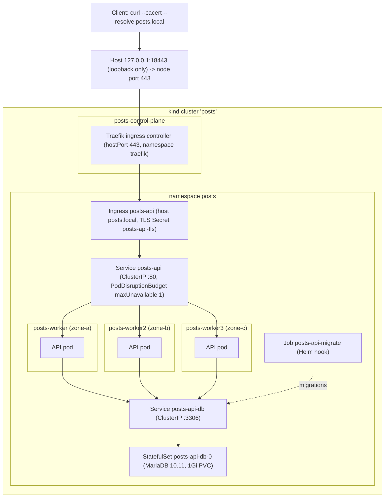
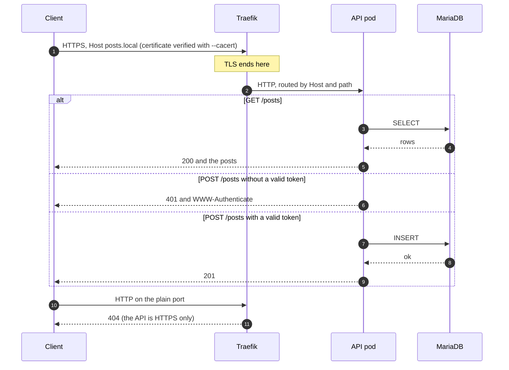
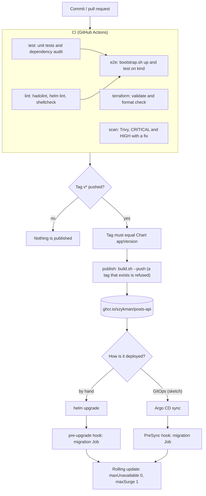
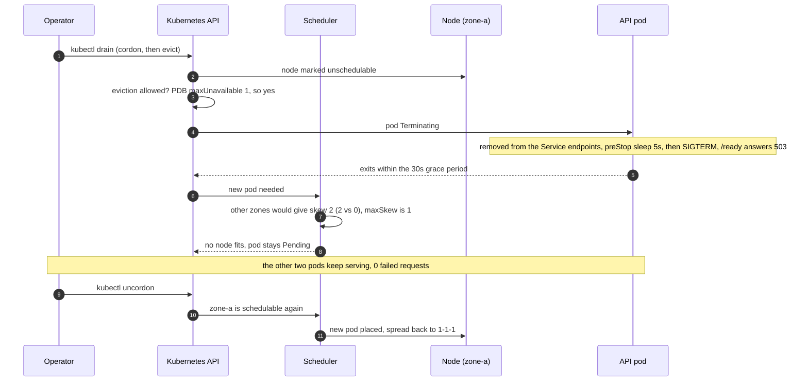
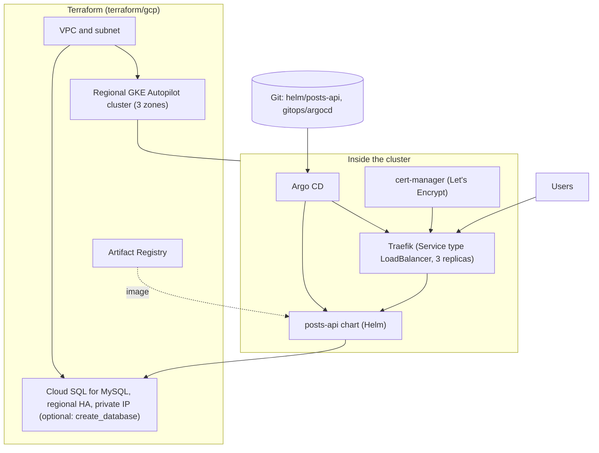
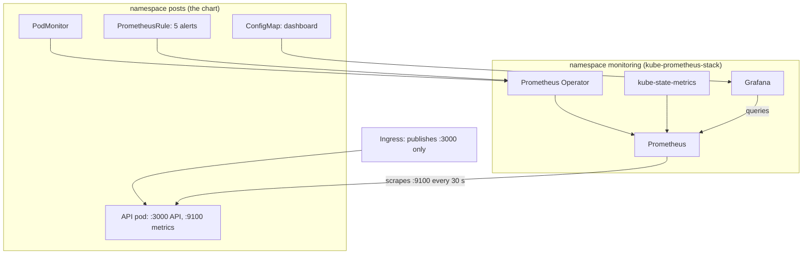

# Architecture

Six diagrams, from the running system to the cloud target. They are written in Mermaid, so GitHub renders them and
they stay in Git next to the code they describe. The README has a short text version of the first one; the reasoning
behind each choice is in [`docs/decisions/`](decisions/).

| # | Diagram | Answers |
|---|---|---|
| 1 | [Runtime architecture](#1-runtime-architecture) | What runs where? |
| 2 | [A request through the ingress](#2-a-request-through-the-ingress) | Where is TLS terminated and where is the token checked? |
| 3 | [From commit to cluster](#3-from-commit-to-cluster) | How does a change reach the cluster, and what stops a bad one? |
| 4 | [Draining a node](#4-draining-a-node) | Why does the API keep answering while a node is taken away? |
| 5 | [GKE target](#5-gke-target-a-sketch-never-applied) | What would production look like? |
| 6 | [Observability](#6-observability-opt-in) | How do the metrics get from a pod to an alert? |

## 1. Runtime architecture

The local cluster is a [kind](https://kind.sigs.k8s.io/) cluster: real Kubernetes, with each node running as a Docker
container. The three workers carry the labels `zone-a`, `zone-b` and `zone-c`, so the zone-aware scheduling is real
even though the zones are simulated.

Points worth knowing:

- Only Traefik is reachable from outside. The database Service is a ClusterIP and nothing is published for it.
- The API pods are spread by `topologySpreadConstraints` (`maxSkew: 1`, `DoNotSchedule`, key
  `topology.kubernetes.io/zone`), one pod per zone.
- The single MariaDB instance is bundled for local and demo use. Its volume is bound to one node, which is why the
  resilience test never drains the node that hosts it. In production the database is managed
  ([ADR 0004](decisions/0004-database-availability.md)).

## 2. A request through the ingress

TLS ends at Traefik. Between Traefik and the pod, and between the pod and the database, traffic is plain
([ADR 0003](decisions/0003-https-at-the-ingress.md)). Writes need a bearer token
([ADR 0002](decisions/0002-authenticate-writes.md)).

## 3. From commit to cluster

Every change goes through the same gates, and publishing is a separate, deliberate step: pushing a `v*` tag.

- `publish` needs `test`, `lint`, `scan` and `e2e` to pass, and only runs for tags, so a push to `main` never
  publishes.
- A failed migration stops the upgrade before any new pod starts, so the old version keeps serving.
- `helm rollback` does not revert the schema, so schema changes must stay backward compatible.

## 4. Draining a node

What `scripts/resilience-test.sh` shows, step by step. With one pod per zone and `DoNotSchedule`, the evicted pod waits
instead of doubling up in another zone.

The PDB protects against voluntary disruptions (drain, upgrade). A node that dies suddenly is an involuntary
disruption; the spread across zones and the readiness probes cover that case.

## 5. GKE target (a sketch, never applied)

`terraform/gcp/` and `gitops/argocd/` describe this. They are validated for syntax in CI and have not been applied to a
real project. See [GKE.md](GKE.md) for the mapping from each local piece.

Terraform owns the infrastructure, Helm owns the application, and Argo CD keeps the cluster equal to Git. Secrets never
go in Git (External Secrets or Sealed Secrets are the planned route, not built).

## 6. Observability (opt-in)

The API exposes its metrics on a separate port, 9100. The Service and the Ingress publish only the API port, so the
metrics are reachable from inside the cluster and never from outside. `scripts/observability.sh up` installs
kube-prometheus-stack and switches on the three objects the chart carries.

- The chart's objects are plain Kubernetes resources; the Operator turns them into Prometheus configuration. That is why
  they are off by default: without the Operator's CRDs a `PodMonitor` cannot even be created.
- A `PodMonitor` is used instead of a `ServiceMonitor` because the Service deliberately does not publish the metrics
  port.
- Alertmanager is not installed locally, so the alerts are evaluated and visible in Prometheus, and nobody is notified.
